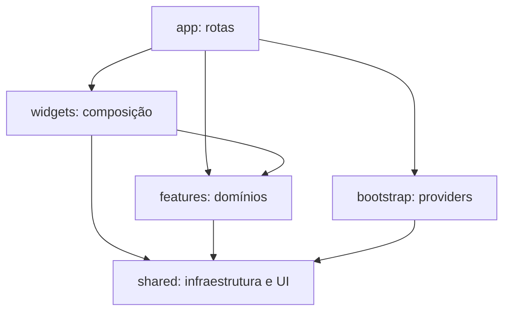

# Arquitetura do frontend

Estado em 11/10/2026: spec 001 implementada; D1 a D6 aprovadas pelo Renato. Contratos, ambiente e qualidade implementados (001); sessão/BFF, transporte, erros e providers implementados (003); tema Quintal em andamento (002); telas de negócio aguardam as próximas specs.

Fonte técnica única no repositório: docs, specs, TSDoc e stories. [Vault](<../../PetHost obsidian/PetHost obsidian/development/frontend-architecture.md>) guarda índices, catálogo e decisões de design. D5: TSDoc + story para componentes e catálogo para reutilizáveis; notas longas apenas para shared/widgets, com apoio transversal agrupado.

## Referência e decisão

O [AquaGas](https://github.com/RenatoGarciaLopes/AquaGas_Frontend) foi analisado no commit `908341db7bd25a44acea7f5629f82c868924f637`, incluindo README, features, providers e clientes HTTP. Preservamos `app`, `features`, `shared`, os segmentos `api`, `components`, `hooks`, `schemas`, `lib` e a separação servidor/navegador. Padronizamos `stores` no plural.

É uma arquitetura por domínio inspirada em Feature-Sliced Design, com `widgets` para composição. Não é FSD estrito: uma feature como `pets` reúne domínio e casos de uso, como no AquaGas. Separar agora `entities/pets` e várias features por ação criaria fronteiras sem reutilização demonstrada. Podemos extrair entities quando houver necessidade concreta. Não usamos `src/pages`, nome reservado ao Pages Router.

Os nomes técnicos seguem os módulos, entidades e recursos do PetHost: `auth`, `users`, `owners`, `hosts`, `pets`, `host-applications`, `listings`, `search`, `availability-blocks`, `bookings`, `payments`, `conversations`, `reviews` e `audit`. Pastas e rotas estão em inglês, com recursos no plural e kebab-case para nomes compostos. Ações administrativas ficam no domínio do recurso; o papel admin não cria um domínio separado. Users representa a conta comum, Owners o perfil de tutor e Hosts o perfil aprovado de anfitrião, respeitando a separação do backend.

## Dependências

`app` concentra arquivos finos de página/layout, loading, erros, autorização de rota e Route Handlers. `bootstrap` compõe providers e configuração global fora das convenções do roteador. `widgets` junta domínios: cantinho + pets + datas + reserva, por exemplo. Uma feature não importa outra; widgets/páginas passam IDs, dados e callbacks. Widgets também não importam outros widgets. `shared` não importa nenhuma camada acima; `shared/auth` contém apenas infraestrutura de sessão e contratos mínimos.

Plop cria entradas index.ts, index.client.ts e index.server.ts quando nasce a feature. Pasta nasce com arquivo. eslint.config.mjs implementa boundaries/dependencies v7: feature importa ela mesma/shared/generated, widget não importa widget, shared não sobe. Slice externa passa por index*. Client em components/client, hooks, stores e _.client não importa server-only/api/server/_.server. no-default-export tem exceções Next/stories/configs/.storybook/Plop. Fronteiras verificadas por testes com fixtures.

## Segmentos das features

| Pasta               | Responsabilidade futura                                                |
| ------------------- | ---------------------------------------------------------------------- |
| `api/server`        | HTTP da feature no servidor; marcado com `server-only`                 |
| `api/client`        | HTTP do navegador para o BFF do Next                                   |
| `api/contracts`     | Reexports e estreitamento de contratos gerados                         |
| `api/mappers`       | Conversão entre contratos e modelos da interface                       |
| `components/server` | Conteúdo sem hooks/eventos e composição no servidor                    |
| `components/client` | Formulários, calendário, uploads e interatividade                      |
| `hooks`             | Comportamento React e mutations                                        |
| `queries`           | Query keys, opções e invalidação                                       |
| `schemas`           | Validação de formulários/entradas                                      |
| `lib`               | Funções puras específicas do domínio                                   |
| `types`             | Modelos da interface, separados dos DTOs                               |
| `stores`            | Estado transitório compartilhado de um fluxo, apenas quando necessário |

## Contratos e Storybook implementados

D1: orval.config.ts gera schemas Zod de openapi/pethost.v1.json versionado em src/shared/api/generated/<tag>/<tag>.zod.ts e index.zod.ts. Tipos via z.infer; nenhum cliente HTTP gerado. scripts/openapi-transformer.mjs normaliza tipos numéricos duplos do .NET 10, preserva null e remove pattern. api:sync baixa e gera, api:generate gera local, api:check detecta diferenças. api/contracts das futuras features estreita o gerado; transporte na 003. Backend deve corrigir campos obrigatérios nullable e enums livres.

D6: Storybook 10 com @storybook/nextjs-vite, a11y test error e viewports desktop/celular. vitest.storybook.config.ts testa stories. Pipeline é temporário; tema Quintal na 002.

## SSR e ilhas

Páginas e layouts permanecem Server Components. Somente a menor fronteira interativa recebe `use client`. Providers client podem envolver filhos renderizados no servidor sem tornar esses filhos Client Components.

É inspiração em Astro Islands: Next usa fronteiras RSC/client, sem prometer hidratação independente ou diretivas do Astro. Client Components também podem ser pré-renderizados no servidor; `use client` não desliga SSR. A home gerada continua estática; SSR de negócio será habilitado nas rotas que dependem de dados da requisição.

Fluxo de servidor: Server Component → feature `api/server` → `shared/api/server` → API .NET diretamente. Fluxo de navegador: ilha → feature `api/client` → `/api/...` no Next → API. SSR não chama o próprio BFF por HTTP.

## Estado e cache

TanStack Query administra **estado remoto**, também no navegador: consultas, mutations, cache, refetch e invalidação. Para ilhas que continuam consultando dados, fazer prefetch no servidor e transferir por `dehydrate`/`HydrationBoundary`. Páginas apenas de leitura podem usar fetch no servidor sem Query.

QueryClient isolado por requisição no servidor e estável no navegador. Query keys incluem domínio, conta/identidade e parâmetros. Limpar dados da conta anterior no logout/troca. Dados privados não entram em cache público compartilhado. Evitar dois caches independentes do Next e Query para a mesma leitura sem estratégia de atualização.

Zustand guarda UI/rascunhos, nunca uma cópia das respostas do Query. Stores por instância de provider, sem singleton compartilhado entre requisições; RSC não lê/escreve store. Estado simples fica no componente; formulários ficam no React Hook Form; filtros compartilháveis ficam na URL. Não persistir tokens, documentos ou fotos em storage. Arquivos de upload ficam em memória durante o formulário.

## Sessão e BFF

Implementado na spec 003 (11/10/2026). Mapa completo, com interface e limites: vault `development/resources/http-and-session.md`.

- **Cookies:** `pethost_at` (Path `/`, vence no `expiresAt`) e `pethost_rt` (Path `/api`, 30 dias), `HttpOnly`, `SameSite=Lax`, `Secure` fora de localhost. O navegador recebe só `{ user }`.
- **Handlers de sessão** (`src/app/api/...`): toda rota que devolve tokens (login, refresh, logout, switch, cadastros, reativações, troca de senha). Fábricas em `src/shared/auth/server/sessionHandlers.ts`.
- **Proxy** `src/app/api/[...path]`: lista permitida `bffRoutes` (método + caminho, testada contra o OpenAPI); autorização por papel fica na API. Multipart em streaming.
- **Refresh:** antes de vencer (menos de 60 s), uma vez por token (`createRefreshSingleFlight`, carência de 10 s); 401 da API renova e repete uma vez (corpo JSON). Refresh recusado: cookies apagados e 401 `SESSION_EXPIRED`; o `QueryProvider` limpa o cache e leva ao login com `next`.
- **RSC:** `getSession()` pergunta à API (`GET /users/me`), nunca confia no JWT. `requireSession(path)` redireciona para `/api/auth/sessions/refresh?next=` (RSC não grava cookie) ou para o login.
- **CSRF:** mutação exige `Origin` do app (ou `APP_ORIGINS`) e `X-PetHost-Request: 1`, que o `bffClient` envia.
- **Transporte:** `HttpTransport` (porta); `createBackendClient` no servidor e `bffClient` no navegador. Nenhuma feature chama `fetch` direto.

**Limites conhecidos:** a execução única do refresh vale para uma instância do Next (várias instâncias precisam de trava distribuída, ex.: Redis); upload multipart não é repetido depois de um 401.

**Requisito na API:** `ForwardedHeaders__Enabled=true` onde o Next roda. O backend confia em loopback e rede privada (`Program.cs`, linhas 147 a 176); sem isso, todos os usuários dividem o limite de requisições do IP do Next e a auditoria grava o IP errado.

Backend usa `/api/v1`; o vault costuma omitir o prefixo.

## Material UI

MUI/Emotion substituem shadcn/Tailwind. `shared/theme` reúne tokens, overrides, variants, extensões TypeScript e aparência futura do Stripe. `bootstrap/providers` deverá compor `AppRouterCacheProvider` de `@mui/material-nextjs/v16-appRouter` (entrada confirmada no pacote instalado), ThemeProvider e QueryClientProvider. O cache do MUI acompanha streaming SSR; não usar `ssr: false` como solução genérica para CSS.

Componentes MUI que estabelecem fronteira client ficam nas ilhas; conteúdo sem interação pode usar HTML/CSS no servidor. O vault define tema Quintal com CSS variables, papel/tinta/coral/grama/gema/céu, Caprasimo e Atkinson Hyperlegible Next, bordas e sombras próprias. Tema e providers aguardam implementação; diretórios vazios removidos. Fontes serão locais; retiramos a fonte remota da demonstração para o build não depender do Google Fonts.

Calendário não pressupõe MUI X Pro: avaliar alternativa sem licença paga na implementação. Stripe, Motion e máscaras entram nas specs correspondentes; bibliotecas de teste já instaladas na 001.

## Sequência proposta

1. Tema/cache SSR, transporte HTTP, erros, sessão/BFF e providers.
2. Login, cadastros por papel, conta e pets, suportados pela API.
3. Verificação, revisão administrativa e consultas de auditoria.
4. Cantinho, descoberta e agenda com contratos novos do backend.
5. Reserva, pagamento/recebimentos, conversa e avaliação.

Todo comportamento desenvolvido exige testes unitários, funcionais, de integração e E2E quando cabíveis. Justificar níveis N/A e documentar casos/resultados na mesma entrega. Pastas de testes estão em src/**tests**, conforme a estratégia de testes; ainda não há casos, configs ou runners implementados.

## Referências consultadas

- [Next: Server e Client Components](https://nextjs.org/docs/app/getting-started/server-and-client-components)
- [Next: create-next-app](https://nextjs.org/docs/app/api-reference/cli/create-next-app)
- [MUI: integração com Next](https://mui.com/material-ui/integrations/nextjs/)
- [TanStack: Advanced Server Rendering](https://tanstack.com/query/latest/docs/framework/react/guides/advanced-ssr)
- [Zustand: Next.js](https://zustand.docs.pmnd.rs/learn/guides/nextjs)
- [FSD: integração com Next](https://feature-sliced.design/docs/guides/tech/with-nextjs)
